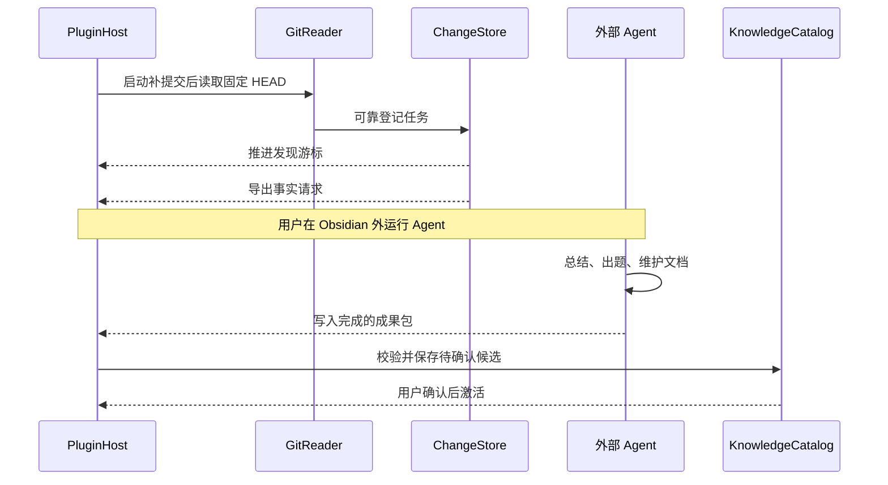
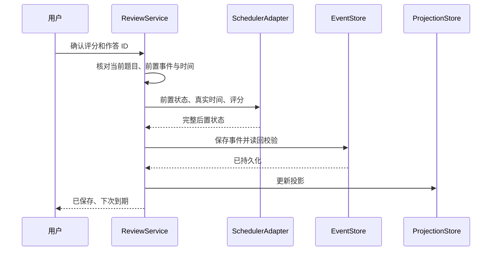

# 数据与架构
版本：0.2。宿主内执行确定性逻辑，语义工作通过文件交给外部 Agent。
## 技术边界
插件使用 TypeScript，按 Obsidian 官方插件接口构建。业务逻辑不依赖 DOM、Obsidian 全局对象或 Git 子进程，通过适配器接入；没有模型服务模块。
首版只在桌面执行本机 Git。Windows Obsidian 使用 Windows 的仓库路径与 Git 可执行程序，Linux 使用 Linux 路径。开发环境为 WSL 不代表发布插件可以直接使用 /mnt/windows-e 路径；不能默认在 Windows 中调用 WSL Git。
构建与依赖版本在开始开发时核对，保存锁文件。当前目录尚无实现或既有代码约定，因此没有可引用的本地错误处理、测试或数据访问范例。
## 模块分层

| 模块 | 输入与输出 | 职责边界 |
| --- | --- | --- |
| PluginHost | Obsidian 生命周期与视图 | 注册命令、展示页面、释放监听 |
| GitReader | 分支和游标 → 提交、blob | 只读、参数化调用，不处理 AI |
| ChangeCollector | blob → 章节变化 | Markdown 事实解析、范围识别 |
| StartupSyncService | 启动状态 → 本地补提交 | 自然日、完整快照与异常保护 |
| CommitTransaction | 私有索引、预期 HEAD → 新提交 | journal、锁、比较更新、恢复 |
| ExternalExchange | 事实请求/结果包 → 回执 | 文件导出导入，不调用 Agent |
| SourceValidator | 结果与来源 → 校验报告 | 格式、版本、引用、路径校验 |
| KnowledgeCatalog | 稳定 ID 与内容版本 | 合并、关系、失效状态 |
| ContextReader | 上下文文件 → 展示与配置 | 只读语义区，合法配置按单一权威编辑 |
| SchedulerAdapter | 状态、评分、时间 → 新状态 | 封装固定版本 ts-fsrs |
| QueuePlanner | 卡片、目标、预算 → 建议队列 | 可解释选题，不改 FSRS |
| ReviewService | 用户作答 → 持久事件 | 幂等、版本检查、评分提交 |
| EventStore | 事件写入与读取 | 单写入、校验、恢复 |
| ProjectionStore | 事件 → 当前视图 | 缓存、索引，可重建 |
| ReminderService | 到期数、策略 → 提醒 | 去重、稍后、焦点恢复 |

业务模块接收 Clock 接口。测试可以推进时间，避免测试依赖真实等待。
后台任务采用小批量和取消令牌。文件交接与 Git 扫描不长期占用评分锁；插件卸载时中止可取消阶段，Git 引用更新阶段必须完成可恢复记录。没有 AI 网络请求。
## 两条核心数据流
### 内容生产

### 真实复习

## 身份与关系

| 实体 | ID 与关联 |
| --- | --- |
| VaultIdentity | 首次建立的随机 vault_id，复制整个 Vault 时可保留或显式分叉 |
| RepositoryBinding | repo_id、分支绑定代号、baseline_sha、根目录本机映射 |
| LearningUnit | unit_id、topic_ids、goal_ids、边界与前置 |
| ReviewCard | card_id、unit_id、learning_epoch_id、当前内容版本 |
| CardContentRevision | revision_id、父版本、题目、rubric、来源引用、hash |
| SourceRevision | source_id、repo_id、commit/blob、路径、章节、短证据 |
| ReviewEvent | event_id、card_id、epoch、前置事件、before/after |
| PracticeTask | practice_id、目标、结果证据；默认不更新 FSRS |
| ChangeBatch | batch_id、提交与来源、事实登记范围 |
| ExchangePackage | package_id、request_id、Manifest hash、处理回执 |
| StartupSyncAttempt | attempt_id、expected_head、tree、归档日、真实捕获时间 |
| StudySession | session_id、活动时长、暂停点、已完成事件 |
| PolicySnapshot | 参数、目标保持率、配置版本及 hash |

ID 使用随机 UUID 等不依赖时间排序的方案。内容 hash 用于完整性和匹配，不能替代实体身份。
同一术语的不同语境可以有多个知识点；合并操作保留 aliases 与旧 ID 跳转。拆分新建 ID，旧记录保留。
## 权威数据与可重建数据

| 位置 | 权威性与用途 |
| --- | --- |
| 原始学习笔记与 Git | 原始笔记正文插件只读；Git 允许 StartupGit 规定的追加提交 |
| Context.md 人工区、主题人工区 | 当前人工声明的目标与进度 |
| Data/Content 下的不可变 JSON 内容版本 | 已发布题目、rubric 和来源证据的权威副本 |
| Data/Events 下的不可变 JSON 事件 | 评分、接受、暂停、纠错、重置等事实 |
| Data/Sources 下的必要证据快照 | 支持历史题目追溯，不依赖原提交一直存在 |
| Items 和 Practice 的 Markdown | 可读视图，手动编辑通过导入流程形成新版本 |
| Exchange/Requests、Imports、Receipts | 可同步的交接请求、成果与回执，仅有新事实才写入 |
| 设备侧任务存储 | 扫描游标、处理状态、启动 journal 和轮询状态 |
| Data/Checkpoints | 事件摘要和快照，加速重建；可重新生成 |
| 插件设备侧缓存 | 搜索索引、临时队列、渲染与未确认输入 |

选择不可变内容副本，是为了在 Markdown 被误改或旧 Git 对象被清理后，仍能解释当时问题与评分。用户日常仍从 Markdown 阅读和编辑。
外部编辑 Items 后，文件监听对比其 base_revision。用户/外部声明补丁后仍需确认；含义变化进入待核查；有双向冲突时保留双方，不能覆盖已发布内容。
“可重建”不意味着自动删除。手动清理入口说明会重建哪些数据，正式数据没有自动递归清理。
## 卡片内容示例
以下字段为项目格式示例，ID 和路径均为示意。
```json
{
    "schema_version": 1,
    "revision_id": "revision_example",
    "card_id": "card_example",
    "unit_id": "unit_et_read",
    "parent_revision_id": null,
    "objective": "解释 ET 处理中通常持续读取到 EAGAIN 的原因",
    "question": "采用非阻塞 socket 和 ET 模式时，为何通常持续读取到 EAGAIN？",
    "rubric": [
        "说明触发语义与仍有未读数据的关系",
        "说明 EAGAIN 是当前无法继续读取的结束条件",
        "指出必须同时处理对端关闭和其他错误"
    ],
    "scope": {
        "operating_system": "Linux",
        "api": "epoll",
        "socket_mode": "nonblocking"
    },
    "source_ids": ["source_example"],
    "estimated_seconds": 90,
    "creation_method": "external_agent_confirmed",
    "created_at": "2026-10-15T07:00:00Z"
}
```
## 复习事件格式
事件至少包含以下字段，真实实现会由 schema 校验完整的调度状态：
- event_id、event_type、schema_version、vault_id、writer_id、session_id。
- card_id、learning_epoch_id、content_revision_id、previous_card_event_id。
- attempt_id，用于双击、重复回包和保存重试去重。
- occurred_at、persisted_at、timezone_at_event、study_day。
- rating、assistance_mode、external_suggestion_ref、effective_duration_ms。
- scheduler_name、package_version、algorithm/config 版本与 PolicySnapshot。
- 完整 before_card、after_card 和该版本库的日志输出；日期序列化为 ISO 字符串。
- 题目版本、证据引用、integrity_hash。
- user_answer 可选，默认不持久保存原始自由文本；用户启用保存时才写入。
参考答案与原始用户回答是不同数据。即使关闭保存用户答案，仍保存最终评分和必要质量标记。
事件覆盖“实际发生了什么”；回答输入未提交时只属于会话草稿。外部评分建议通过文件关联真实 attempt，经用户确认后采用。插件不发送答案给任何模型服务。
## 状态重建
1. 校验 VaultIdentity、schema 和检查点 hash。
2. 加载检查点，再核对其覆盖的事件 ID 与内容版本是否存在。
3. 按每张卡的 previous_card_event_id 链读取后续事件，检查 before/after 连续性。
4. 有效评分采用保存的 after_card 恢复当前状态，不用新算法重算。
5. 暂停、归档和管理事件更新业务状态；撤销事件使对应评分在当前投影中失效。
6. 独立重建到期索引、队列、摘要和统计。
7. 发现事件缺失、内容缺失或分叉时隔离受影响卡片，其他完整卡片继续工作。
有效检查点必须与事件清单核对；检查点之后出现撤销、内容变更或来源失效时，重放相关管理事件，而不是只读取最新评分。
事件关系决定因果顺序，文件名和系统时间只辅助展示。hash 用于检测损坏，不提供签名认证或防恶意篡改保证。
完整性计算使用项目定义的规范 JSON 表示，排除 integrity_hash 字段；UTF-8、键排序、数值和日期规则写入 schema。题目原始正文保持原字节副本，不能为规范化校验而改变代码语义。
## 写入协议
首版使用同一进程的串行写入队列和桌面本机写入者检查。评分操作：
1. 在锁内检查 attempt_id 是否已有有效事件，校验 expected previous event 与内容版本。
2. 计算调度结果并构造完整事件，写入同目录临时文件。
3. 读回并验证 schema、内容 hash 和引用。
4. 通过适配器发布为最终唯一文件名，读回核验后返回成功。
5. 更新缓存和 Markdown 投影；投影失败只标记待修复，不重复评分。
首次发布内容时先保存内容版本，再保存激活事件。意外留下的未引用内容可列为孤立项，不作为活跃卡。
不能假设所有同步盘、操作系统或 Vault adapter 的 rename 都具备一致的原子和持久化语义。最低要求是忽略临时文件、校验最终内容、识别部分发布，并在 Windows/Linux 实测。
如需对断电后持久性作更强保证，桌面适配器应评估 fsync 和目录刷新能力；文档与界面不承诺尚未验证的“零丢失”。
## 崩溃恢复

| 中断点 | 恢复结果 |
| --- | --- |
| 评分前退出 | 不产生评分事件 |
| 临时事件写了一半 | 不进入有效历史，提示重做或恢复草稿 |
| 最终事件完整，缓存未更新 | 重放一次，恢复已评分结果 |
| 已保存但用户没看到确认 | 根据 attempt_id 找回结果，不重复评分 |
| 内容版本写入，激活事件未写 | 内容保持未激活，不进入到期队列 |
| 扫描任务保存，游标未推进 | 重扫时 discovery_key 去重 |
| 游标已推进，外部尚未处理 | 从已登记 ChangeBatch 和交接请求继续 |
| 外部成果已发布，导入尚未完成 | 按 package/proposal ID 幂等恢复 |
| 补提交分支已更新、索引未发布 | 先恢复独立 Git journal，再继续内容扫描 |

磁盘满、权限变化或同步文件锁时，界面明确显示“未保存”，停留当前题目并保留内存输入，不继续静默累计作答。
## 撤销与修正
首版支持撤销该卡最新有效评分，即使之后复习了其他卡也可以。追加撤销事件并恢复 before_card，原事件保留。
同卡已经存在后续评分时，禁止直接撤销中间事件。后续版本可提供整链重算预览，首版只支持附纠错说明并调整今后状态。
修改评级也通过撤销最新事件后创建替代事件完成；替代记录保留原 occurred_at、修正时间和关联 ID，不伪造第二次学习。
关闭或重新打开插件不会丢失持久化的撤销关系。统计排除被撤销记录。
## 多窗口与多设备
同一进程的多个窗口共享 ReviewService；弹出窗口也通过同一服务提交，重复 attempt_id 无效。
不同进程或设备的离线并发写入不属于首版支持范围。本机锁不能充当分布式锁，Git/同步盘也不提供这个保证。
配置 writer_id，其他设备默认只读。切换写入设备前要求先同步并验证完整事件；旧设备之后仍可能离线写入，因此必须检测同卡前置事件分叉。
检测到两个有效后继时暂停受影响卡片，展示双方作答与时间，用户选择保留哪条链或作为练习保留另一条。不能简单按时间戳最后写入覆盖。
复制 Vault 用作另一个独立知识库时，提供“保留同一身份继续使用”或“创建新身份”的显式入口。
## 数据保留、导出与迁移
导出包括 schema、题目内容、必要证据、事件、配置快照及完整性清单；默认不含原始自由文本答案和设备缓存；插件不保存 AI 密钥。
仅有 Git 提交在本机不等于异地备份。由用户自行决定远端与同步方式，插件提供缺失引用检查和恢复演练，不自动推送。
schema 升级先生成用户可见的迁移预览和本次导出副本，成功验证后切换；旧格式不能原地破坏。遇到比当前插件更新的 schema，进入只读兼容模式。
用户要求删除敏感回答或内容时，说明其可能仍存在于 Git 历史和已同步副本。插件仅能处理当前可访问数据，历史清理需单独明确操作。
## 启动提交与文件交换
Git 提交事务使用独立的设备侧 journal，不能把新提交伪装成 ReviewEvent。仓库快照需要保存复习事件，但 Git 归档日期不会修改事件中的 occurred_at。
自动检查完成时间、当前焦点、轮询状态、任务发现游标只保存在本机。不在被跟踪文件中每次更新 last_open，以免产生永远脏的循环。
导入包以 Manifest/Ready 为完整性边界；按 package_id 和 proposal_id 逐项持久记录，支持部分接受。回执失败时可由已接受管理事件恢复，不重复激活卡片。
外部 Agent 只能读取已发布 Content/Events；修改通过 Imports 或手动导入形成新版本。语义 Context/Topics/Digests 由外部维护，插件不自动覆写。
详细事务与格式见 [StartupGit.md](StartupGit.md)、[ExternalAgent.md](ExternalAgent.md)。
## 本地配置与安全
插件不持有 AI 凭证、不实现模型客户端。外部工具的权限、密钥和费用由用户在该工具中管理，插件不读取其配置、日志或运行数据库。
日志只记录任务 ID、阶段、状态、耗时和错误码。正文、答案、密钥及完整请求默认不写日志；调试导出需用户主动触发并可预览。
Git 子进程使用参数数组，关闭 shell 插值，校验路径在仓库允许范围内，禁用外部 diff/textconv 和交互提示，设置超时、输出上限并支持终止。
禁止沿源文件符号链接读取允许目录外的内容；检查实际路径。临时文件和成果包声明路径不能突破已授权根目录。
Markdown 渲染使用 Obsidian 的受支持接口，不执行外部成果中的脚本或任意 HTML 事件。
## 性能目标
这些是待实测的验收目标，不是当前实现结果：
- 10,000 张卡、100,000 条事件的样例库，在有有效检查点时优先恢复本地复习入口，目标约 2 秒内可用。
- 文件交接和 Git 扫描不阻塞 UI；完整冷重建显示进度，Git 写入临界阶段按 journal 协议恢复。
- 扫描 Git 按批次读取，限制单文件、单请求和单轮总量；大库不一次性载入全部正文。
- 事件存储首版按月分目录、每事件一文件。通过检查点减少打开时逐文件读取，导出可打包；若多小文件成为瓶颈，再设计可验证的分段压缩迁移。
- 生产可接受上限由实测决定，超出时明确降级，不承诺所有同步工具均适用。
