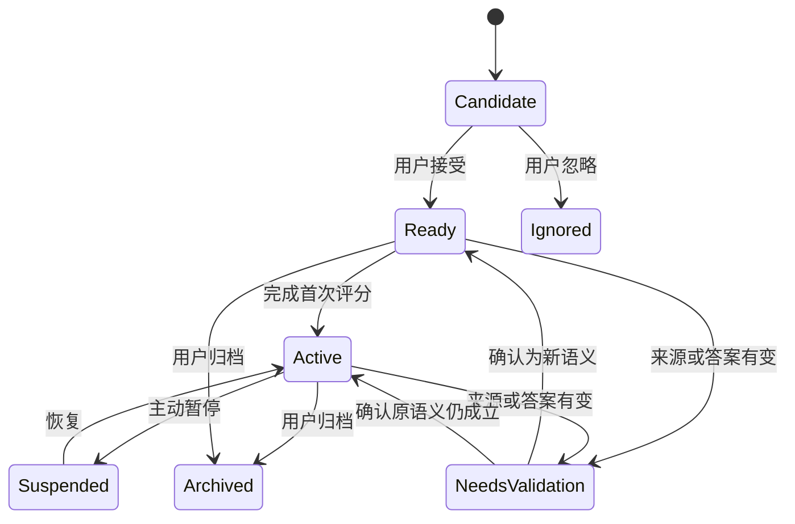

# 复习调度
版本：0.2。FSRS 和队列由插件确定性计算，语义规划和质量评估交由外部 Agent。
## 调度职责
FSRS 负责记忆状态和下一次到期时间；QueuePlanner 负责在可用时间内选择任务；ReminderService 负责何时提醒。三个模块分别保存状态，避免“今天不想做”被理解成“已经复习”。
使用固定版本的 ts-fsrs，通过适配层调用其公开接口，序列化完整 Card 状态。实现时核对所选版本的接口、日期转换、短时调度与许可。
## 时间模型

| 字段 | 语义 |
| --- | --- |
| occurred_at | 实际评分发生的 UTC 时间 |
| persisted_at | 事件成功保存的 UTC 时间 |
| last_review | 调度器记录的上次真实复习时间 |
| due_at | 调度器给出的下一次理想到期时间 |
| snoozed_until | 用户要求隐藏本卡或提醒至某时刻 |
| suspended_at | 主动暂停的时间 |
| selected_at | 今日任务选择时间 |
| study_day | 以指定时区和分界时间计算的学习日 |
| timezone_at_event | 作答时的时区 |
| effective_duration_ms | 剔除后台停顿后的作答时长 |

所有实际间隔按绝对时间计算；学习日仅用于预算统计、摘要和提醒去重。默认时区 Asia/Shanghai，学习日从 04:00 开始，均可修改。
跨时区旅行时，用户决定是否更改展示时区。修改时区不会重写已有 UTC 记录，也不会重置 FSRS。
长期间隔按库输出的真实 due_at 判断；学习日和偏好时段只控制展示与提醒，不将 due_at 私自取整到零点。到期落在睡眠时段时，等应用下次可见再提醒。
发现当前墙上时间早于该卡最后一条有效事件，暂停该卡评分写入并提示核对系统时间。计时长用单调时钟，实际事件时刻用墙上时钟。
## 卡片状态
业务生命周期与 FSRS 内部状态分开。
### 业务生命周期

- Candidate 尚不属于复习负债。
- Ready 为待首次检验，不具有“逾期未复习”的含义。
- Active 才进入通常的到期判断。
- NeedsValidation 阻止出题，待来源或答案核对。
- Suspended、Archived 保留历史，但不自动进入今日队列。
FSRS 的 New、Learning、Review、Relearning 按包版本映射保存，不能与上述业务状态混用。
### 首次作答
用户接受候选时创建未学习卡和初始状态，记录 accepted_at。初始 due 字段只作为待首次检验的展示候选，不据此计算遗忘风险。
首次真实作答在当前时间调用调度器。无法回答记 Again，之后阅读答案进入重新学习；能够回忆则按真实表现评分。
历史提交很久以前发生时仍使用首次实际检验时间。除非导入具有可信作答时间的外部复习记录，否则不填补历史。
## 评分语义

| 评分 | 成立条件 | 不应包含的情况 |
| --- | --- | --- |
| Again | 无法独立回忆主要答案，或关键机制错误 | 临时没空、题目歧义 |
| Hard | 已独立答对，但回忆困难 | 忘了以后看答案才觉得熟悉 |
| Good | 独立答对，难度正常 | 只阅读、跳过 |
| Easy | 独立、迅速且完整答对 | 题目过于提示答案 |

外部 Agent 的评分建议引用与用户最终评分分别保存。插件不执行 AI 评分。Hard 的语义必须明确为成功回忆。[Anki 对 FSRS 评分的说明](https://docs.ankiweb.net/manual/deck-options)。
## 下一次日期的计算
输入为完整前置卡片状态、实际答题时间、确认评分、参数快照和调度器版本。输出为完整后置状态与库提供的复习日志。
```text
验证卡片版本和真实时间
    → 生成幂等作答 ID
    → 调用 SchedulerAdapter 计算状态
    → 形成同时包含 before / after / rating / time 的事件
    → 持久保存并校验
    → 更新可重建投影
    → 返回已保存和下一次日期
```
默认关闭随机间隔扰动，降低恢复与验证复杂度；未来启用时同时保存扰动配置和最终输出。历史恢复使用已保存结果，不以新版算法悄悄重算旧记录。
未来日历默认只展示已确定的下一次到期。更远日期如需展示，使用“假设之后均为 Good”的估计，并标明假设。
## 短间隔与重新学习
首版让所选 ts-fsrs 版本负责短时与长期调度，不再叠加自制的 1、2、4、7 天阶梯。集成验证必须确认 Again 的短时结果与用户体验。
新一轮短时复习到期时，只有用户仍在会话且预算允许才继续展示。离开后保留原 due_at，下一次恢复时处理。
同一会话内默认每卡最多 2 次重新出现；达到上限后建议结束或拆题。上限只影响展示，不将 due_at 强制改成明天，也不写入虚假的成功。
如果未来需要自定义学习步骤，应作为独立配置与迁移设计，不能无提示修改调度结果。
## 漏复习规则
缺席只会使时间继续经过。到期卡的 overdue 属性由 now 与 due_at 比较得出，不需要每天创建一条缺席事件。
示例：10 月 1 日实际作答，10 月 4 日到期，10 月 8 日才回来。10 月 8 日只有一张逾期卡；作答以 10 月 8 日和距上次实际复习 7 天作为输入。
一次回答只能产生一次有效记忆更新。不会补建 10 月 4 日、5 日、6 日各一次失败，不会要求把所有预计检查点逐个补做。
逾期后成功回忆有时会得到较长的新间隔，这由算法和实际结果决定，不因“惩罚迟到”统一缩短。
## 稍后、暂停、假期与归档

| 操作 | 影响 | 恢复规则 |
| --- | --- | --- |
| 稍后提醒 | 改提醒时间 | 到时重新提醒，记忆状态不变 |
| 本卡今天稍后做 | 改本卡 snoozed_until | 解除隐藏后按原 due_at 判断 |
| 暂停主题 | 隐藏该主题自动任务 | 恢复时使用真实经过时间 |
| 假期模式 | 全局暂停提醒和新卡激活 | 回来后进入恢复模式 |
| 降低优先级 | 改任务选择顺序 | 不改卡片事实 |
| 归档 | 长期退出自动队列 | 显式恢复，保留历史 |
| 重置学习状态 | 创建新的学习周期 | 必须显式选择，旧历史保留 |

假期无法暂停真实遗忘。可以调整恢复后的执行负担，但不能把最后复习时间顺延假期天数。
重置周期需要独立 learning_epoch_id，区分此前历史与新一轮学习，未来拟合也据此筛选。
## 今日队列
### 默认参数

| 参数 | 默认 | 属性 |
| --- | --- | --- |
| 每学习日预算 | 10 分钟 | 用户可改 |
| 快速会话 | 3 分钟 | 当次覆盖 |
| 每学习日新卡首次检验上限 | 3 张 | 接受候选不消耗，首次检验消耗 |
| 新卡时间占比上限 | 20% | 有旧卡时优先满足旧卡 |
| 同一卡会话内重新出现上限 | 2 次 | 含初次展示后的重新出现 |
| 超时前提示 | 预计下一题超预算时 | 可主动继续 |
| 目标保持率 | 0.90 | 初始产品设置，非保证值 |
| 任务耗时冷启动 | 90 秒/基础题 | 随有效作答历史更新 |
| 恢复模式预算建议 | 原预算的 50%，至少提供一题入口 | 用户可改 |

QueuePlanner 首先过滤暂停、来源失效、版本冲突、未到解除时间的卡，再选择已到期 Active 卡。Ready 卡只在新卡配额和预算允许时补入。
### 排序与预算
首版使用可解释的分组与稳定排序，暂不训练复杂权重模型。
1. 当次明确指定的任务与已到期重新学习卡优先，但不能无限占满会话。
2. 其余到期卡综合当前目标、遗忘风险与等待时间排序。
3. 每次常规 10 分钟会话在可行时保留一席给等待最久的卡，避免低优先级永久饥饿。
4. 预计耗时从时间预算扣除；预算放不下一题时提供“做这一题后结束”。
5. 初次检验在旧卡处理后补入；同源卡未来按学习日避让。
实现可使用以下初始分数，所有分量归一化到 0 至 1：
```text
priority = 0.30 * goal_relevance
         + 0.30 * forgetting_risk
         + 0.20 * waiting_age
         + 0.20 * recent_failure
```
这些权重仅为产品假设。记忆概率只用于已学习卡；默认参数下显示为估计，不能解释为个体真实概率。
预算选择保留等待最久的一席后，对其他候选使用 priority / sqrt(estimated_minutes) 做软排序，同时给超过一个学习日未被选中的长题单独入口。复杂长题属于练习区，不混入基础卡预算。
### 重规划
一题完成后刷新该卡状态与剩余预算，不在用户作答中途替换当前问题。临时目标变化只影响未开始题目。
接受大量候选不会立即塞入今日计划；Ready 队列的首次检验仍受每日限制。用户可批量撤销候选接受。
### 积压识别
当到期卡预计总耗时超过 3 倍每日预算，或持续 3 个学习日净增长时，建议进入积压模式。
积压模式暂停新的首次检验，保留候选收集；新卡进入不会被删除。用户可主动例外检验一张。
退出条件：到期预计总耗时降至 1.5 倍每日预算以下。使用不同进入/退出阈值，避免模式反复切换。
长时间未打开时，使用绝对时间和现有到期量判断；不能假定缺席期间用户每日花过预算。
### 多次打开与提前练习
同一学习日共享已用预算和首次检验计数。用户仍可选择“再做一轮”，显示为额外投入。
手动打开未到期卡默认是练习，不改调度。明确选择计入复习时才调用适配层，并保存真实时间、受提示标记和来源版本。
用户刚完成 Again 并看过答案时，必须到达调度器给出的短时 due_at 后才能进入下一次正式回忆；此前再次查看仅记练习。未来出现同源互补题时，默认本学习日避让，防止答案互相提示。
## 保持率与参数修改
更改目标保持率后默认只影响之后的调度，不立即重排所有旧卡。设置页展示这一语义。
显式批量重排作为后续能力，需要预览数量、保存参数版本和可回退的管理事件。管理重排不冒充真实作答。
首版不自动拟合个性化参数。后续拟合需要样本质量检查，排除受提示、歧义题、冲突事件和不可信导入。
## 重复失败
同卡最近 5 次有效回忆中有 3 次 Again 时，提示检查粒度、前置知识或参考答案。默认不自动删除或暂停。
用户可选择拆题、补学前置、暂停，或继续使用。拆题后子卡创建新 ID，旧卡归档，历史通过 derived_from 关联，不能复制旧卡的稳定性作为新卡事实。
## 统计边界
按时率仅计算真实 due 与真实作答的关系。缺席日显示未作答，暂停日单独标记。
回忆成功率的分母仅包含合格的实际回忆事件，Hard、Good、Easy 记成功，Again 记失败。首次检验、同日重新学习、长期复习分组显示，避免混合掩盖问题。
材料阅读进度、复习覆盖率和回忆成功率分别呈现，不能合成一个没有依据的“掌握度百分比”。
## 外部规划与补提交日期
外部 Agent 可以修改语义学习计划，并提交预算、优先级、暂停主题或目标保持率提案。经用户确认后成为新的策略版本；插件不自行生成学习建议。
归档到昨天的 Git 补提交不改变任何卡的真实 last_review，也不初始化过去的成功。首次检验和迟到复习使用实际发生时间。
外部 Plan 中的手工阅读/实践日期可以直接形成经确认的手动任务。FSRS 卡片的下次 due 仍由真实作答决定；外部建议日期单列 execution_hint。
没有题目的来源提醒属于 ReadingTask，不加入 Active 卡片、回忆成功率或逾期估计。已阅读只能记录为阅读事实。
导入外部评级时必须关联真实 attempt、内容版本与实际时间，并经用户确认；旧评级的纠正遵循事件撤销规则。
